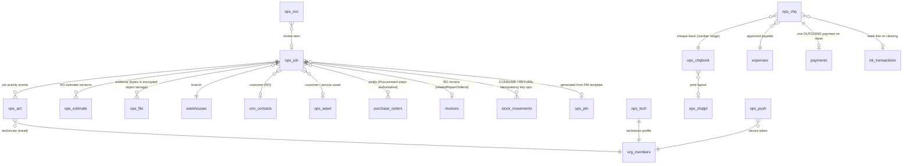
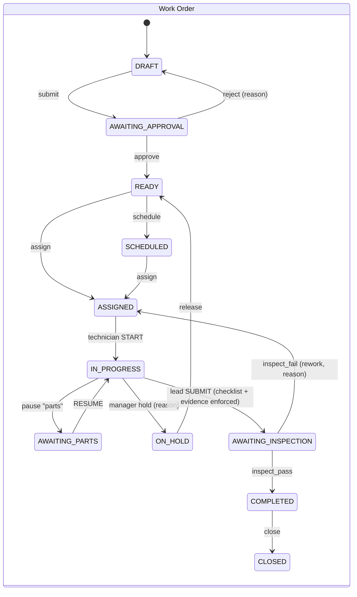
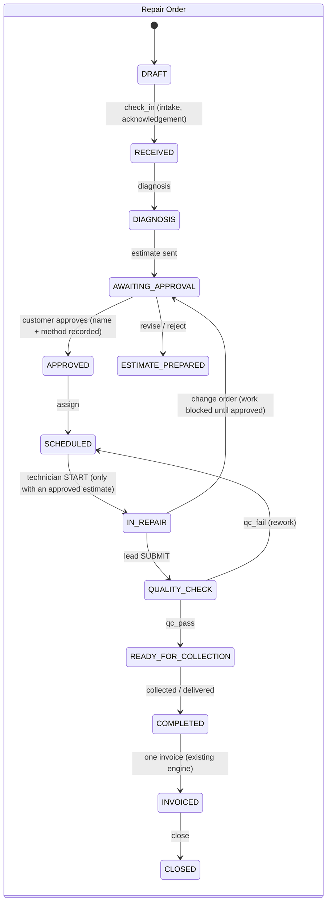
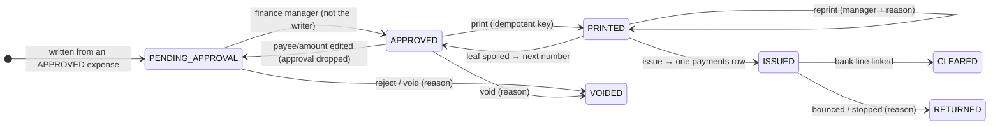

# Manage Orders — design (SOW §25 deliverables 3–11)

Companion to `PHASE0_AUDIT.md` (audit + reuse matrix) and `RELEASE_NOTES.md` (runbook, limitations, rollback).

## 1. Data model and relationships (deliverable 3)

All new records live in the existing `calendar_records` collection (`opsDoc: true`, `kind` below). Arrows point to existing, authoritative records.



Uniqueness: `opsKey` (unique per org) = `job:<number>`, `act:<idempotency key>`, `est:<job>:<version>`, `chq:<book>:<number>`, `tech:<email>`, `site:<code>`, `push:<token>`, `exc:<type>:<key>`, `lock:tech:<email>`; `opsKey2` (unique per org) = `pm:<template>:<due date>` on generated jobs, `chqexp:<expense>` while a cheque for that payable is live. Attendance stays in `w_punch` / `w_shift` / `w_correction` (workforce), never copied.

## 2. State machines (deliverable 7)





Cancel (with reason) is allowed from every open state; it releases reserved stock. Every transition is one atomic update filtered on the expected current status, then audited.



## 3. API and events (deliverable 4)

One router: `/api/orgs/ops/...` (list in the route header). Every call: session → membership → entitlement → role → branch → (technicians) assignment. Idempotency keys on job activity, parts consume/return, cheque print, attendance punches. Integration events (existing signed webhook registry, PII-minimised: action, previous/new state, number): `work_order.created`, `work_order.status_changed`, `repair_order.created`, `repair_order.status_changed`, `job.assigned`, `job.activity`, `cheque.status_changed`. Cron `/api/cron/ops` every 15 min: preventive maintenance + review scan.

## 4. Permission matrix (deliverable 5)

| Action | Owner/admin | Manager | Dispatcher | Service advisor | Technician | Storekeeper | Finance staff | Finance manager |
|---|---|---|---|---|---|---|---|---|
| See all orders in my branches | ✓ | ✓ | ✓ | ✓ | own jobs only | ✓ | – | – |
| Create work order | ✓ | ✓ | – | – | – | – | – | – |
| Create repair order, intake, estimate, customer decision | ✓ | ✓ | – | ✓ | – | – | – | – |
| Approve / inspect / QC / close / cancel | ✓ | ✓ | – | – | – | – | – | – |
| Assign, reschedule, override (reason) | ✓ | ✓ | ✓ | – | – | – | – | – |
| Start/pause/resume/submit, checklist, notes, photos | (manager acting needs reason) | ✓ | – | – | own jobs | – | – | – |
| Request parts | ✓ | ✓ | – | ✓ | own jobs | – | – | – |
| Approve request, reserve, return, release parts | ✓ | ✓ | – | – | – | ✓ | – | – |
| Record parts used | ✓ | ✓ | – | – | own jobs | ✓ | – | – |
| Review queue, corrections (different manager) | ✓ | ✓ | – | – | explain own | – | – | – |
| Write / issue / reconcile cheque | ✓ | – | – | – | – | – | ✓ | ✓ |
| Approve / reprint / spoil / void cheque, layouts, books, cost rates | ✓ | – | – | – | – | – | – | ✓ |
| Settings, roles, sites, PM templates | ✓ | ✓ (roles: owner/admin) | – | – | – | – | – | – |

Branch scope (Time & Rota › Manage users) applies to every row; branch is never overridable. Technicians never see customer details for jobs not assigned to them.

## 5. Mobile workflow and screen map (deliverable 6)

```mermaid
flowchart LR
  Home[Business home] -->|My jobs| Day[My day: attendance, current job, today, upcoming, updates, waiting-on-phone banner]
  Push[Lock-screen notification] -->|tap| Job
  Day -->|clock in/out, breaks| Punch[(Time & Rota punch, online only)]
  Day --> Job[Job: acknowledge · start (site code / QR / one-time location) · pause (reason) · resume · submit · flag]
  Job --> Check[Checklist ticks]
  Job --> Photo[Camera / gallery / file → encrypted storage]
  Job --> Parts[Request part · record used]
  Job --> Notes[Notes]
  Job -. no signal .-> Queue[(Offline queue on phone: pending → synced / failed / needs review)]
  Queue -. back online .-> Job
```

GitHub edition only; the Play Store edition is unchanged. Native camera/QR/location load only on builds that contain them.

## 6. Scheduler and technician chart (deliverable 8)

Lanes per technician with attendance state (from punches), each assignment's scheduled block, actual first start, estimated vs active minutes and a chart state that never infers work from attendance: Not scheduled · Scheduled, not started · Clocked in, no job started · Job in progress · Paused · Awaiting parts · Awaiting customer approval · Awaiting inspection · Completed · Overdue/review. Side lists: unassigned, overdue, at risk (due < 24 h, not started), stalled (no activity 48 h). Eligibility: hard = active member, technician/manager role, active profile, branch; soft (override with reason) = skills, category, expired certification, approved leave, outside published shift, overlapping bookings (beyond max concurrent). A per-technician lock prevents two dispatchers double-booking.

## 7. Attendance vs job verification and privacy (deliverable 9)

Attendance (`w_punch`) and job labour (`ops_act`) are separate records; labour minutes are recomputed from events (START/RESUME → PAUSE/SUBMIT) plus approved CORRECTION events. Verification at job start: site code (QR or typed) or a one-time location fix when the company enables it; distance beyond the radius creates a review item, never a verdict; refusal falls back to site code or supervisor. No background or out-of-hours tracking. Review items: clocked in with no job started, scheduled job not started, paused too long, outside radius, no verification when required, incomplete submission, unauthorised attempt, labour variance, many attendance corrections, late/implausible offline actions, safety flags. Actions: acknowledge, request explanation (person can reply), escalate, resolve, dismiss (reason), approve/reject correction (different manager). Nothing changes pay or triggers discipline.

## 8. Cheque lifecycle and print templates (deliverable 10)

See the state diagram above. Layouts are millimetre positions (date digits with spacing, payee, amount in words with line gap, amount in figures, memo, "A/C PAYEE ONLY") plus page size and nudge offsets; presets Generic Pakistan / HBL / Meezan / MCB are starting points, aligned per customer with a plain-paper test print that never touches a cheque. Amounts in words use lakh/crore for PKR, thousand/million otherwise.

## 9. Migration and rollback (deliverable 11)

No migration of existing data: new kinds only, 5 partial indexes created on first use (`ops_key`, `ops_key2`, `ops_list`, `ops_assignee`, `ops_job_ref`). Rollback: `FEATURE_MANAGE_ORDERS=off` (instant), then optionally revert the commits; `ops_*` documents are inert without the code.
